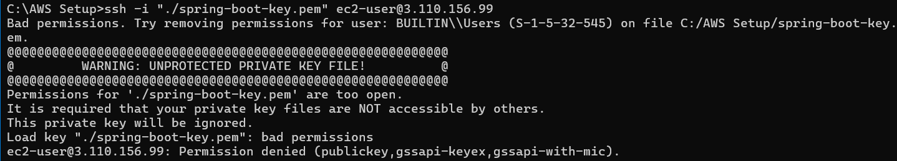

### USER SCRIPT FOR INSTALLING EC2 DEPENDENCIES

```bash
#!/bin/bash

# Log output for troubleshooting
exec > >(tee -a /var/log/user-data.log) 2>&1

set -euxo pipefail

echo "Updating installed packages..."
dnf update -y

echo "Installing Git..."
dnf install -y git

echo "Installing Java 17..."
dnf install -y java-17-amazon-corretto-devel

echo "Verifying installations..."
git --version
java -version
javac -version

echo "EC2 initialization completed successfully."
```

### Permission Issue for the PEM File
While connecting to the EC2 instance : 
``` 
ssh -i "C:\AWS Setup\spring-boot-key.pem" ec2-user@3.110.156.99
```



#### For Windows
``` 
icacls "C:\AWS Setup\spring-boot-key.pem" /inheritance:r
icacls "C:\AWS Setup\spring-boot-key.pem" /grant:r "%USERDOMAIN%\%USERNAME%:R" "SYSTEM:R"
icacls "C:\AWS Setup\spring-boot-key.pem" /remove "BUILTIN\Users"
```

``` 
[ec2-user@ip-172-31-11-118 ec2-volume]$ ./gradlew bootRun
-bash: ./gradlew: Permission denied
[ec2-user@ip-172-31-11-118 ec2-volume]$ chmod +x gradlew
[ec2-user@ip-172-31-11-118 ec2-volume]$ ./gradlew bootRun
Fetching distribution.
Downloading https://services.gradle.org/distributions/gradle-9.8.0-bin.zip
..............10%..............20%...............30%..............40%...............50%..............60%...............70%..............80%...............90%..............100%
```


# 1. EC2 User Data debugging — command cheat sheet

## A. Cloud-init diagnostics

| Command                                     | Purpose                                                          |
| ------------------------------------------- | ---------------------------------------------------------------- |
| `sudo cloud-init status --long`             | Check cloud-init's overall status and errors.                    |
| `sudo cat /var/log/cloud-init-output.log`   | View captured output from User Data and other cloud-init stages. |
| `sudo cat /var/log/cloud-init.log`          | Inspect detailed cloud-init logs and tracebacks.                 |
| `sudo cat /var/log/user-data.log`           | View your custom script log, if configured.                      |
| `sudo journalctl -u cloud-final --no-pager` | Inspect logs for the cloud-final systemd service.                |

## B. Find the failure

| Command                                                                                       | Purpose                                                                                          |
| --------------------------------------------------------------------------------------------- | ------------------------------------------------------------------------------------------------ |
| `sudo grep -iE 'user-data\\|error\\|failed\\|traceback' /var/log/cloud-init.log \\| tail -50` | Search recent matching log lines.                                                                |
| `sudo ls -l /var/lib/cloud/instance/scripts/`                                                 | List scripts cloud-init executed or staged.                                                      |
| `sudo cat /var/lib/cloud/instance/scripts/part-001`                                           | Inspect the actual script stored by cloud-init.                                                  |
| `sudo bash -x /var/lib/cloud/instance/scripts/part-001`                                       | Execute the script with command-by-command tracing enabled. Caution: this reruns its operations. |
| `sudo grep -n -A 20 -B 10 -iE 'error\\|failed\\|traceback\\|dnf' /var/log/cloud-init.log`     | Show matching errors with surrounding context.                                                   |

## C. Linux permissions and installation checks

| Command               | Purpose                                                 |
| --------------------- | ------------------------------------------------------- |
| `ls -l gradlew`       | Inspect file permissions, including execute permission. |
| `chmod +x gradlew`    | Make the Gradle wrapper executable.                     |
| `git --version`       | Verify Git installation.                                |
| `java -version`       | Verify the Java runtime version.                        |
| `javac -version`      | Verify the Java compiler version.                       |
| `cat /etc/os-release` | Identify the Linux distribution and version.            |

## D. Useful logging commands for future scripts

```
# Append script output to a dedicated log and cloud-init's captured output
exec > >(tee -a /var/log/user-data.log) 2>&1

# Exit on command errors, unset variables and pipeline failures
set -euxo pipefail

# Print the command being executed
set -x
```

- `tee -a` writes output to the log while displaying it on the terminal or the connected output stream.
- `-e` exits on many unhandled command failures.
- `-u` catches references to unset variables.
- `-x` traces commands before execution.
- `pipefail` makes a pipeline fail if a command within it fails, rather than reporting only the last command's status.

Note that `set -e` has exceptions; it does not catch every possible failure in every Bash context.

# 2. Lessons learned about EC2 User Data

1\. User Data normally runs only on the first boot

Cloud-init typically executes a User Data script once per instance. A normal reboot does not automatically rerun it.

2\. A generic failure message isn't the root cause

`Failed to run module scripts-user` tells you that script execution failed, not which command caused it. Inspect the script's own output and the surrounding logs.

3\. Redirect output before running installation commands

Logging should be configured at the beginning of the script. Otherwise, the detailed error may never reach your custom log.

4\. Use Bash tracing to find the failing command

Running a script with `bash -x` exposes the commands being executed. Combined with exit-on-error behavior, it can pinpoint where execution stops.

5\. A successful rerun doesn't explain an earlier failure

Your script succeeded when rerun manually, but that does not establish why it failed during boot. The original error wasn't captured in the evidence we found.

6\. Make scripts fail clearly

Use strict Bash options, meaningful step names, timestamps, exit codes, and an error trap. This makes future failures easier to investigate.

7\. Prefer idempotent operations

A provisioning script should ideally be safe to execute again. Package installation is generally repeatable; destructive file operations and application deployment require more care.

8\. Separate provisioning from application lifecycle management

Use User Data for initial setup, such as installing dependencies. For keeping your Spring Boot application running and restarting it after a reboot, use `systemd`.

## 3. Your troubleshooting sequence for next time

Memorize this order rather than trying random fixes:

1\. Check status

`sudo cloud-init status --long`

2\. Read output logs

`sudo cat /var/log/cloud-init-output.log`

`sudo cat /var/log/user-data.log`

3\. Inspect the executed script

`sudo cat /var/lib/cloud/instance/scripts/part-001`

4\. Reproduce with tracing

`sudo bash -x /var/lib/cloud/instance/scripts/part-001`

Inspect first; rerunning can repeat operations.

The biggest takeaway: Don't settle for a generic error message, but also recognize when the available evidence is insufficient to establish the original cause. Good logging makes the next investigation faster, even when it cannot guarantee that every failure will be self-explanatory.

You've now gone beyond simply launching an EC2 instance: you've worked with Linux permissions, cloud-init, shell error handling, application ports, and Spring Boot deployment. Those are practical skills worth keeping.